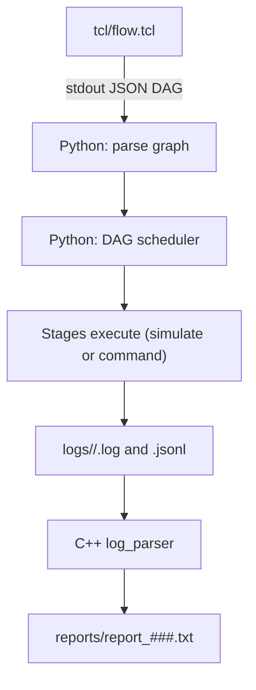
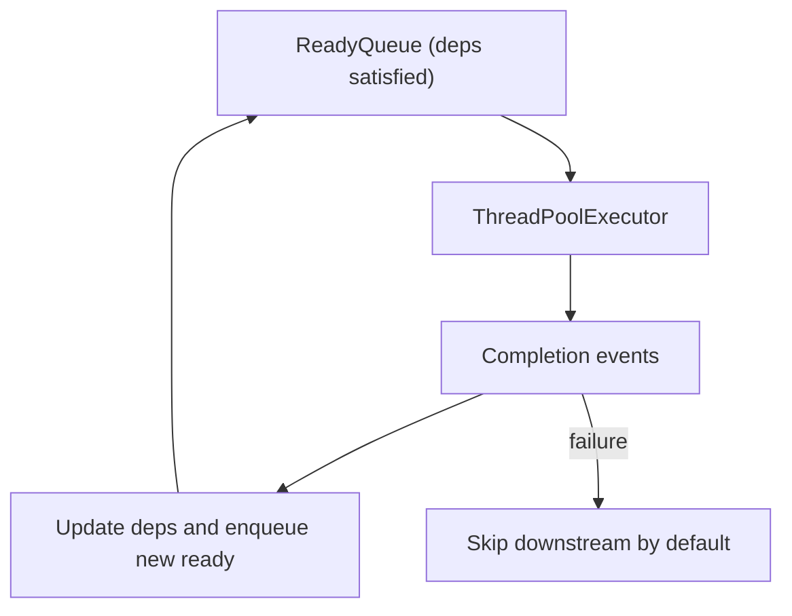

# Configurable Design Flow Automation Framework

An engineering-style framework that simulates **CAD/EDA design flows** (including **DFT** and **DFP** methodology stages) using:
- **Python (core engine)**
- **TCL (flow orchestration)**
- **C++ (high-performance log parsing)**

## Why this is relevant (CAD/DFT/DFP tooling)
- **Design-flow automation**: configurable flows, retries, and reporting.
- **Modular/OOP architecture**: `Stage` abstraction + pluggable stage implementations.
- **Mixed-language integration**: TCL defines the flow graph, Python executes, C++ parses logs.
- **Methodology layering**: DFT (scan/ATPG) and DFP (power intent/analysis) stages run in the same pipeline.

## Project structure
- `main.py`
- `config/sample_config.json`
- `core/` (engine + abstractions)
- `stages/` (stage implementations)
- `tcl/flow.tcl` (structured flow graph output)
- `cpp/log_parser.cpp` (log parsing)
- `utils/` (logger + parser interface + command runner)
- `logs/` (generated per run, partitioned by run name)
- `reports/report.txt` (generated per run)

## Prerequisites
- Python **3.12**
- `tclsh` available on your PATH
- A C++17 compiler (macOS: `clang++`)

## Build the C++ log parser
From the repo root:

```bash
clang++ -O2 -std=c++17 -o cpp/log_parser cpp/log_parser.cpp
```

## Run the TCL flow script (optional)

```bash
tclsh tcl/flow.tcl
```

It prints a JSON payload describing the flow graph; Python captures this output when `use_tcl: true`.

### CAD/DFT/DFP flows included
By default, `tcl/flow.tcl` enables a mixed flow to demonstrate methodology layering:
- **Core CAD**: `synthesis → placement → timing`
- **DFT**: `dft_scan_insertion → dft_atpg`
- **DFP**: `dfp_power_intent → dfp_power_analysis`

To change the flow order or toggle DFT/DFP, edit `tcl/flow.tcl` (JSON DAG output) or set `"use_tcl": false` and provide `graph.stages` in the config.

## High-level flow (chart)



## DAG scheduling (chart)



## Run the framework

```bash
python3 main.py --config config/sample_config.json
```

Outputs:
- Stage logs: `logs/<run_name>/<stage>.log`, plus structured `logs/<run_name>/<stage>.jsonl`
- Report: `reports/report_###.txt` (auto-incremented each run)

## Useful CLI options (CAD-style)
- `--dry-run`: print planned DAG execution
- `--resume`: skip stages with matching checkpoint metadata (`logs/<run_name>/<stage>.meta.json`)
- `--only <stage>`: run a single stage and its required dependencies
- `--from <stage>` / `--until <stage>`: run a slice of the DAG
- `--max-workers N`: cap parallelism when `parallel: true`

## Configuration knobs
`config/sample_config.json` demonstrates:
- `parallel`: run stages concurrently (simulation)
- `retries`: retry failed stages
- `use_tcl`: read stage order from `tcl/flow.tcl`
- `graph.stages`: DAG definition (used when `use_tcl` is false)
- `seed`: deterministic-ish simulation
- `failure_rate`: probability of simulated failure per stage attempt
- `variants`: run multiple configurations and pick the best by `(errors, warnings, runtime)`

### Graph schema (non-TCL mode)

```json
{
  "use_tcl": false,
  "graph": {
    "stages": [
      { "name": "synthesis", "depends_on": [] },
      { "name": "placement", "depends_on": ["synthesis"] },
      { "name": "timing", "depends_on": ["placement"] }
    ]
  }
}
```

### Stage tool-wrapper mode (optional)
You can switch a stage to run an external command:
- `stage_modes.<stage_name> = "command"`
- `stage_commands.<stage_name> = ["bash","-lc","echo hello"]`
- `stage_timeouts_s.<stage_name> = 30`

## Recruiter-friendly quick demo
Run this and open the latest report in `reports/`:

```bash
python3 main.py --config config/sample_config.json
```

Then mention:
- the flow is a **DAG**, not a fixed list
- **TCL** is used for flow definition (common in CAD)
- **C++** is used for fast log parsing (performance-critical tooling)
- the same engine runs **CAD + DFT + DFP** stages and aggregates results

